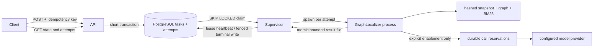
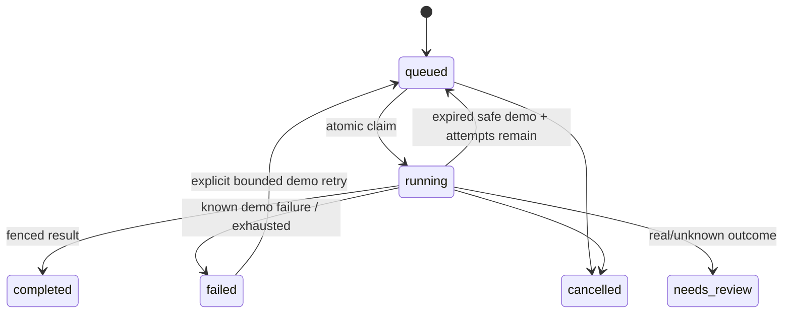

# Local task service architecture

## Ownership

API validates and persists requests; it never imports/runs the graph engine.
PostgreSQL owns durable state and attempt history. A supervisor owns a lease, not
permanent authority. Every terminal write and heartbeat first acquires the row
lock, then checks database wall-clock expiry and the complete claim identity.
The child process exclusively owns legacy graph globals for one attempt.

Child results are at most 16 MiB and published atomically only after complete
JSON serialization and fsync. Partial writes cannot block supervision.
The supervisor terminates/reaps the child when cancelled, expired, stopped or
unable to maintain storage connectivity. Linux parent-death handling prevents
orphaned real-provider calls from continuing after supervisor SIGKILL.

## States and recovery

Completed localization still distinguishes success, empty and iteration_limit.
The cancelled transition does not imply a provider request was never billed.
There is no automatic replay path from needs_review. v1 interrupted work has
unknown outcome and is quarantined during the explicit migration.

## Fixed sources and evaluation

Preparation uses an immutable Git archive, builds local graph/BM25 indexes, and
hashes all artifacts plus engine code. The manifest is addressed by its hash.
The scorer's patch-derived answers are separate and never sent to the provider.
Plans predeclare samples, paired arms, denominator, options and budget.
Fixture results intentionally leave real quality/token/cost fields null.
Only completed results contribute scores. Missing, corrupt, invalid or abnormally
terminated child records become failures; raw child bytes are retained separately.
The fixed denominator and billing ledger survive these failures; an uncertain live
attempt stops future calls but still produces a summary.

A paid request is reserved and fsynced before network I/O. Unknown calls halt the
experiment and keep their entire reservation. Completed responses are recorded
before model-output parsing. Reported tokens from failed attempts still count.
Provider aliases and peak price snapshots are provenance, not immutable remote
weights or invoice guarantees. The 65,536 input threshold is a local UTF-8 byte
estimate plus a 4,096 framing allowance, not a provider-enforced token cap.
The v2 pilot reserves the full 1,048,576-token context plus 512 output tokens for
every call, independent of that heuristic: CNY 3.151872 each / 18.911232 for six.
A fresh account-pricing confirmation is bound to the plan hash and checked before
any live output/ledger is created and before every provider call. Three calls per
arm are enforced durably. A separate stable lock serializes atomic ledger replacement;
file and directory fsync precede network I/O. No reservation is refunded.
Legacy v1 plans are offline-only. CLI --live enables only the current process after
explicit env-file loading; it never rewrites the file. SDK caller overrides are
filtered. The approved real pilot completed six calls after pricing confirmation;
its one-time approval and full reservations remain consumed.
Public constraints/rates and account assumptions must hold for the reservation math;
local bookkeeping is not a provider-side account spending cap.

## Operational scope

Local, single-trust-domain service. No authentication, multi-tenancy, automatic
data deletion or public deployment. PostgreSQL fencing protects database writes;
it cannot provide exactly-once remote billing. Worker processes isolate global
state; they are not an arbitrary-code sandbox. Trusted pickle indexes are accepted
only from the operator's hashed registry.

Compose keeps PostgreSQL and worker on an internal network; only API also joins
the ingress bridge and publishes 127.0.0.1:18080. Local-demo PostgreSQL uses trust
authentication on this isolated network, without creating credentials or exposing
a host database port. This profile is not a public/production deployment.

## First-pilot approval boundary

One project-fixed O_EXCL marker consumes the initial CNY 20 approval exactly once,
before creating a run ledger. It is bound to the approved plan hash, confirmation
hash, ledger absolute path and ownership token. Every call verifies this binding.
Different output directories, copied ledgers and refreshed confirmations cannot
mint another budget. Interrupted markers remain consumed; there is no automatic
reset/reclaim command. This is a single local approval, not one approval per run.
The CLI validates the actual pricing file and approved plan before env-file loading;
missing, malformed, stale or mismatched confirmations cannot trigger that loader.

Ledger initialization and provider construction resolve and pin the canonical absolute
path. Authorization, locking, reads and atomic replacement use this same path, including
when the input is a relative path or symlink. Input aliases are never replaced by saves.

The explicit zero-use recovery entry point permits one audited migration only for the
exact approved predecessor ledger with zero calls and zero reservation. It preserves
the prior marker/ledger in an audit record and binds the replacement plan and ledger.
Known or unknown calls, mismatched provenance and interrupted audit persistence fail
closed. This migration was used once for the local input-gate failure; it does not
authorize replay of the subsequently completed six-call pilot.

## Explicit bounded search protocol

The isolated `GraphLocalizer` owns graph globals under the same per-process lock.
A source manifest may explicitly select `bounded-v1`; absent that setting the
legacy loop/parser remains active. This changes no worker, lease, fencing, retry
or payment ownership rules.

The bounded loop validates exact structured locations against its graph, restricts
the last provider request to the finish tool, and fails closed on truncated or
missing submission. A per-run output cache paginates tool returns by actual JSON
message bytes; full raw returns are kept only in diagnostics. The context ledger
is updated from delivered messages, never from withheld tails. Continuations
reference only this in-memory cache and cannot read arbitrary files. Current caps
are 8 KiB per tool message, 24 KiB cumulative tool messages and the unchanged
65,536-byte request estimate gate (including 4 KiB reserve). These are model-input
bounds, not a CPU, memory or stored-diagnostic size quota.

Bounded tool display annotates graph-backed file/function/class IDs with valid
finish payloads. Variable aliases are file-level targets; a class with no separate
constructor node points to the class while retaining its source. These hints do
not normalize, filter or salvage submitted locations: exact all-or-nothing
validation is unchanged. Internal display flags cannot be supplied by the model.
Legacy tools omit this metadata. The traversal formatter is included in newly
prepared source engine hashes; old manifests/indexes remain untouched.

## Prepared-source compatibility boundaries

The wire/storage `TaskRequest` has a 32,768-character ceiling; its ordinary demo
path retains the 8,000-character limit. API admission validates an exact prepared
manifest under the idempotency lock. Direct `CreateTask` construction and worker
execution also verify long prepared inputs. Internal database deserialization
context preserves reads of accepted records after source files move; JSON cannot
supply that context or admit a new forged source. No input truncation is performed.

Preparation archives the exact commit tree to avoid Git `export-subst` mutations,
rejects gitlinks before archive extraction, and compares every ordinary Python
path/blob with `git ls-tree`. The opt-in image-link omission audit is included in
manifest artifacts. Normalized internal `../` image targets are allowed, while
escaping, chained, cyclic, executable and code targets are rejected. No link is
extracted, followed or expanded.

Gold patches and candidate labels remain in scoring-only artifacts. Prepared tasks,
graph/BM25 indexes, IPC payloads and provider messages contain only the frozen issue
and base repository information. Sentinel tests exercise this data path, but the
worker shares local filesystem privileges: separation is logical, not an OS sandbox.
The evaluator uses explicit per-source function applicability and retains failed/
missing rows as zero within fixed denominators. Unrepresentable function truth is
retained rather than substituted with class IDs.

## Separate phased offline execution

The phased CLI coordinates reviewed fixed cohorts outside the HTTP task queue.
It reuses the existing atomic fsync/replace writer, canonical ledger lock and strict
original-response usage validator; existing paid ledgers and approval gates remain
unchanged. Each arm still runs GraphLocalizer in a separate process with Linux
parent-death protection and a fenced run token.

A nonblocking phase lock admits one runner/auditor. A separate owner marker binds
the canonical ledger path, immutable plan, token, revision and current state hash.
It prevents a copied or rolled-back ledger from creating new authority. A ledger
write followed by an interrupted marker update requires explicit audit of the
single linked next revision; malformed or inconsistent states fail closed.
These local files must be retained together; this is not an adversarial filesystem
or distributed exactly-once guarantee.

Reservations precede transport. Original response bytes are persisted losslessly
as base64 before strict usage validation and settlement. Results are persisted
before their ledger reference; a phase checkpoint follows all its arm results.
Recovery can adopt a complete result or replay only already settled responses into
an isolated local engine. Every replayed request must hash identically; unknown
responses never cause automatic retransmission or reservation release.

Model children do not load scoring labels. Label hashes are checked by the parent
at planning, initialization, every stage and recovery; summary reads the frozen
labels afterward. Source manifests, runtime files, interpreter and installed
dependency inventory are also fixed. Label separation remains logical rather
than an OS sandbox. Live execution is separately gated by exact-plan admission, explicit authorization and fresh pricing.

### Complete project behavior binding

The phased runner computes a conservative package closure via engine_binding.py:
all Python modules including package initializers in locagent_service, util,
plugins, dependency_graph and repo_index, plus Jinja prompts, Tree-sitter .scm
queries, SQL migrations, the legacy metric module and requirement declarations.
This covers dynamic plugin discovery as well as the static imports exercised by
GraphLocalizer. Additions, deletions and content changes alter the binding;
symlinks fail closed. The tests check every local static import against this set.

Prepared manifests bind the 110 behavior inputs. Plans additionally bind
phased_cohorts.json (111 files total); keeping cohort source IDs at plan level
avoids a circular manifest hash. verify_sources rejects legacy partial behavior
maps even when a newly generated plan otherwise validates. Installed dependencies
still require the exact pip-freeze digest and interpreter version.

The repair creates child manifests over the same verified bundles, retaining
parent_source_id and exact artifact maps. Source-keyed labels are remapped without
changing their targets or applicability. Previous plans, ledgers and results are
preserved; no old result becomes a result under the repaired plan. This is a local
reproducibility boundary, not a defense against malicious filesystem administrators.

### Shared raw HTTP transport and external live admission

deepseek_http.py extracts the already reviewed followup payload filtering and
no-retry/no-redirect HTTPX client. The historical followup entry still uses its
existing post/status behavior; the phased path reads bounded chunks so a partial
body and error status can be retained before any settlement. All conversion to
ModelResponse happens after durable raw bytes and strict followup usage validation.

phased_admission.py validates an operator-issued record in a dedicated trusted
local store. It binds the canonical final plan, runtime/labels/metrics, official
endpoint/model, exact per-cohort budget and call limits, full reservation basis,
human approval reference, independent review and fresh plan-bound pricing. This is
a local administrative trust boundary, not a cryptographic approval service.
There is no command that grants approval. The CLI generates only invalid drafts.

Initialization exclusively claims the approval ID and the plan owner; either
partial write remains consumed. Live, HTTP simulation and legacy offline ownership
have separate namespaces. Simulation can execute the identical live candidate plan
with MockTransport without approval, network or credentials, but always records
offline metrics. It cannot be promoted by changing a flag or reused as a live ledger.

Before each new provider call, validate the frozen runtime/state/approval, normalize
and size-check the wire payload, reserve durably, and only then send once. Persist
HTTP status, completion flag, original received bytes and SHA256 before settling.
4xx/5xx/redirects, timeouts, partial bodies, invalid usage or persistence uncertainty
never release the full reservation automatically. Known durable responses can only
be reconstructed after explicit audit with identical request hashes.

### Bounded response files and readable audits

response_store.py prevents raw bodies from inflating JSON ledgers. For each call,
write a bounded body to an exclusively created temporary file, fsync it, publish
with an exclusive hard link, remove the temporary name and fsync the directory.
Only then commit the immutable file/byte-count/SHA256 reference. Application code
never overwrites a body; external changes are detected by length and hash checks.
A failed or interrupted publication retains any temporary/orphan evidence and its
storage charge. Unknown calls remain blocked even if an unreferenced file exists:
HTTP status/completeness may not have reached durable metadata.

The transport's receive limit is min(8 MiB, remaining per-ledger 32 MiB raw quota).
Any received prefix at overflow is explicitly incomplete and cannot settle, even
if it already parses as valid usage JSON. Metadata writes use the same exact JSON
serialization size as the existing 8 MiB strict reader and refuse an oversized
replacement, leaving the previous durable JSON readable.

Normal load/execute validates every referenced body. Audit has a narrowly scoped
evidence-error read mode: it still validates the frozen plan, ledger structure,
owner head and approval, then records a blocked audit for missing/changed bodies.
It does not bypass evidence verification for settlement or future spending.
Previously settled accounting is retained on later evidence loss; unsettled calls
keep their original full reservations. No legacy inline-body ledger is migrated.

## Phased v3 terminal failures

The phase parent keeps the exclusive phase lock across every child. Only
child_executor issues a ReapedProtocolError, after wait() returns the expected
Python failure code and a signal-0 process-group probe confirms that the owned
group no longer exists. Exit uncertainty, a surviving group, or an unrelated
exception aborts the cohort.

The parent revalidates the canonical owner heads, active token/index, all call
settlements, the persisted child error, and the last response's malformed JSON
arguments. It commits a failure proof with plan/source/arm identity, call-chain
hash, raw response hash, run token and exact exit evidence, then reads both
durable heads back before proceeding. Failure proof verification is part of
every subsequent ledger read. A successful artifact cannot coexist with an
eligible failure. Other failed/blocked arms are not phase-terminal.

Each v3 checkpoint hashes ordered {status, sha256} entries for all arms in the
phase. Successful entries reference result hashes; safe failures reference
failure-proof hashes. Complete means all phases are durably checkpointed, not
all arms succeeded. Scoring still uses only completed results; failures score
zero with fixed 20/18 denominators and existing NA/gold rules. The
quality_claim_allowed flag means a complete real experiment may be reported,
including 100% failure; it does not claim an improvement. Generic summary's
terminal_failure_verified is an internal caller attestation supplied only after
phased ledger validation, not an external client assertion.

Partial writes, lost ownership, unknown cost, corrupt evidence and process
uncertainty stop the batch. Explicit audit can reconcile a fully durable
checkpoint's lagging owner head, but never infer executor exit from a free
lock/dead parent or replay a failed arm. Protocol v2 plans fail exact v3 plan
validation; historical ledgers and consumed approvals are not migrated.

### Evidence-loss audit (R2)

A forensic audit can validate available ledger/proof/accounting structure when
a previously settled raw response is missing or corrupt. That exception is
limited to recording a nonrecoverable response_evidence_invalid halt. Normal
reads and scoring remain strict. The audit preserves all charges, reservations,
call statuses and original references/proofs, records prior active/fault state,
blocks running arms and clears active_run without claiming executor exit.
Neither returning body bytes later nor an available phase lock permits resume.
The owned-head commit does not reread damaged bodies; write failures propagate
instead of returning a successful audit result.

## Empty-query retrieval boundary

BM25 fallbacks reject tokenless queries before ranking or fuzzy fallback; exact graph/entity matches retain priority. Nonempty backend failures propagate with a sanitized type/stack cause chain; the public execution_error contract, phased continuation whitelist and accounting are unchanged. See [EMPTY_QUERY_BOUNDARY_ACCEPTANCE.md](EMPTY_QUERY_BOUNDARY_ACCEPTANCE.md).

## Public distribution boundary

The local phased_cohorts.json and operational evidence are untracked. The example has no samples/bindings and zero budget; it is not an executable or authorized plan. Portable tests synthesize cohorts and bodies in temporary stores. NEW20_REAL_EVALUATION.md summarizes the independently reviewed real result. Core suppression defaults off; existing HTTP TaskOptions defaults on. These defaults are unchanged.
