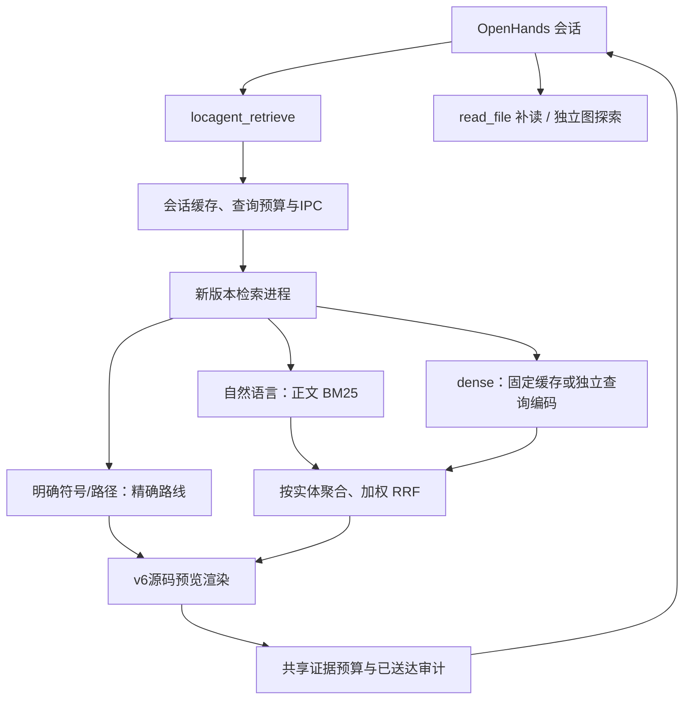

# 完整混合检索接入 OpenHands：差距审查与实施路线

2026-11-16。结论：完整混合检索的算法与大部分原语仍在，新 OpenHands 路径没有完整迁入。此前将 v6 的“实体/路径/BM25组合”简称为混合检索，会混淆旧的“正文BM25＋dense＋加权RRF”，此处纠正。现有 SDK 实验不能代表原完整混合方案的效果。

本次检查源码、历史验收文档和本机产物位置，执行45项相关离线回归，全部通过、零跳过、零网络连接尝试。没有调用LLM/embedding、读密钥、启动数据库或改变冻结的v7代码。下面的架构是实施建议，尚未宣称完成SDK混合接线。

## 1. 为什么没有接入

最初 OpenHands 适配明确采用最小只读桥接：实体精确读取＋实体ID BM25＋基础搜索/按行读取。原文在 workspace/README.md 和 ENGINE_COMPATIBILITY_REPORT.md 中明确排除了正文corpus、embedding、图扩展和旧候选控制策略。之后的v4路径增强、v6证据呈现、v7自检都是沿这条窄接口逐项推进；没有补齐完整混合检索的能力对齐。

这是迁移范围未完成，不是 OpenHands 不支持混合检索，也没有证据表明旧完整方案被验证无效后主动淘汰。可以确认“当时只接了哪些能力”，不能凭后来的源码推断所有历史决策动机。

实际入口：`sdk_finish_selfcheck_v7/worker.py:16` 只调用 `load_graph()` 获得图和实体BM25，随后选择 EvidenceRetriever；它丢弃 `verify()` 返回的正文索引状态。原生组 worker 则在 `cohort_finish_v5/worker.py:46` 加载正文索引并连接 `bm25_content_retrieve`。两者不是相同检索组合。

## 2. 原先优化的方案究竟是什么

expanded50 的冻结实现采用：

- 固定仓库/commit，函数AST区域分块，max_chars=12000，文档输入为 `path:QualifiedName` 换行加代码正文；含tests/docs函数范围。
- 正文 BM25：Lucene k1=1.5、b=0.75、English stemming/stopwords，严格正分候选。
- 真实 embedding：历史模型标识 `qwen3.7-text-embedding-flash`，1024维，document/query角色区分；归一化后精确余弦。
- 同一实体多个块取最大分，实体去重后排名。
- 加权RRF：`1/(60+BM25名次) + 2/(60+dense名次)`，缺席臂贡献0；没有预截断，分数相同按实体字符串排序。
- 文件排名从最佳函数排名投影。

关键实现：[prepare_expanded50.py:62](/Users/xiaomu/Projects/LocAgent-OpenHands/legacy/locagent-demo/scripts/prepare_expanded50.py:62)、[evaluate_expanded_resumed.py:86](/Users/xiaomu/Projects/LocAgent-OpenHands/legacy/locagent-demo/scripts/evaluate_expanded_resumed.py:86)、[entity_ranking / rrf](/Users/xiaomu/Projects/LocAgent-OpenHands/legacy/locagent-demo/scripts/offline_bailian_rrf.py:22)。

历史报告记载9814个文档向量与50个查询向量，函数主评30题的Recall@5为BM25 52.22%、dense 55.56%、加权RRF 64.44%。这是历史独立检索实验的报告值，本次没有找到对应原始结果和向量目录重新复算，也不是OpenHands端到端成绩。完整图探索未在该三臂检索实验中单独证明增益。

## 3. 能力差距

| 能力 | 已有实现 | 当前 OpenHands v7 | 接入工作 |
|---|---|---|---|
| 精确实体/限定名、路径候选 | 原图工具、v4/v6 | 已接入 | 保留，作为显式符号查询路线 |
| 实体ID BM25 | 图实体索引 | 已接入 | 作为v6对照保留；不能称正文BM25 |
| 正文 BM25 | 当前原生组有80行索引；旧混合实验有AST函数块索引 | 未接入 | 可先复用80行索引建立正文检索基线；恢复旧混合算法时须另建相同AST块正文索引，二者不能混称 |
| dense精确余弦 | `ExactIndex`、`PgExactIndex`、向量校验 | 未接入 | 文档向量绑定、查询向量来源、预算与超时 |
| dense2/BM251 RRF60 | 离线优化/评估脚本中已实现 | 未接入 | 提取纯排序模块，保留实体最大块分与确定性平分规则 |
| 旧服务 hybrid 开关 | `GraphModuleRetriever`、HTTP任务配置 | 未接入SDK；且当前适配器是等权RRF | 不能直接用mode=hybrid冒充优化过的加权版本 |
| 结构化源码预览 | v6优先实现、重叠抑制、范围提示 | 已接入 | 拆成独立渲染器，接收融合排名，不用旧符号重排覆盖dense结果 |
| 图邻接/依赖探索 | `explore_graph_structure` 等图工具 | 未注册到SDK | 单独提供有界图探索工具，记录关系类型/方向/深度；与融合检索分开对照 |
| 候选状态/补读 | 旧 `candidate_evidence`、`autonomous_reread`、`candidate_drilldown` | 未迁入；v7只有文字自检 | 接成会话候选状态和模型可选择的补读操作，不能直接搬旧Agent循环 |
| 查询缓存/模式与降级审计 | 旧服务有固定缓存和diagnostics | SDK只有普通文本工具结果 | 传递 requested/executed mode、index/config hash、降级原因、来源分数与预算 |

### 不能直接替换一个类的原因

1. v6直接访问 `base._lexical.corpus`、`similarity_top_k`，并假定检索对象是实体BM25；旧 `GraphModuleRetriever` 不提供相同完整接口。不能简单把 `_lexical` 换成它。
2. v6会按符号组件重新排序，可能压过dense召回；需将候选生成/融合与预览渲染分离。
3. 旧HTTP适配器的BM25是调用者提供的实体索引；优化实验的BM25搜索代码正文。即使打开hybrid，候选、权重和分块仍不一致。
4. 旧HTTP默认chunker为2000字符，expanded50采用12000字符、函数块和名称前缀。缓存键、成员集合、输入内容和过滤规则不同，历史向量不能凭函数名直接复用。
5. 当前SDK查询限制256字符，模型生成查询与旧实验固定问题文本不同；旧缓存按查询原始UTF-8文本哈希命中。历史50个查询向量不足以服务任意Agent新查询。

## 4. 本机现有资产与阻塞

已比对 `LocAgent-rag-preview`、原 `locagent-demo-20261108`、新项目 `legacy/locagent-demo`：rag_offline、rag_graph_adapter、rag_http、offline_bailian_rrf、evaluate_expanded_resumed五个关键文件在三处哈希一致，旧实现未因本次项目整理丢失。

在上述三个检出目录的预期位置，均未找到 `outputs/bailian-expanded50-resumed-evaluation-20261016-r01/results.json`、`outputs/bailian-retrieval-20261016/`、`outputs/bailian-rrf-offline-20261016/comparison.json`。这只说明所检查检出中的历史产物缺失，不断言整台电脑或原Windows/Linux机器不存在。旧RAG_HTTP文档也注明真实向量/查询缓存尚未迁入。

代码和文档足以开始免费离线接线。要使用旧真实向量，仍需找回原manifest、文档输入、响应/向量与来源绑定，按内容hash、模型、维度、角色及成员范围验明后转换。若新源码或新查询无缓存，则需要独立的embedding生成步骤；此前DeepSeek聊天验证的授权不包含该供应商/数据范围。

## 5. 推荐接入架构

建议保留OpenHands为唯一Agent控制循环，复用旧检索原语和图工具；不让检索worker内部再运行GraphLocalizer与第二个LLM循环。现有SDK只要求 `snapshot_id` 与 `retrieve(query) -> str`，所以后端替换无需重写SDK。图探索需要另注册Action/Executor，不能仅更换retrieve内部实现就声称已开放。

先用本地只读 `ExactIndex`，pgvector已有独立实现但不是首轮接入前置条件。保留每会话查询缓存，分页复用同一结果，不重复编码；对多个不同查询，可在单题隔离worker生命周期内复用索引，保持跨题/跨组隔离。

新计划显式记录检索模式、文档与查询编码版本、分块策略、成员清单、BM25参数、RRF参数、候选截断策略、缓存身份及降级策略。现有v7计划字段是严格白名单，直接添加这些配置会被拒绝，因此应新建例如 `sdk_hybrid_v8`，不修改历史v7或重签旧结果。

## 6. 分阶段实施与验收

### A. 恢复可复用的检索模块（免费）

- 新建纯候选模块：正文打分、dense打分、实体最大块分、加权RRF、确定性排序。算法来源绑定到旧优化版本。
- 定义统一Candidate：entity_id、path、span、来源、各臂分数/名次、融合分数、snapshot/index/config hash。
- 把v6预览逻辑移入新版本独立renderer；原v6保持原样。
- 验收：合成排名与旧函数精确一致；实体去重先于top-k；非正BM25、同分、空结果、错版本、BOM/隐藏文件与候选过滤均有明确处理。不用新规则静默删源码。

### B. 接入实际OpenHands工具循环（免费模拟）

- 新worker根据冻结配置构建检索器，通过现有IPC返回文本及本地审计元数据。
- 初期使用合成向量和缓存查询，跑真实SDK分派/分页/终答流程。明确标记synthetic，仅验证接线。
- 复用证据、工具调用与请求预算；向量/索引故障保留诊断。若允许BM25降级，必须明确记录实际模式，不能仍记作hybrid成功。
- 验收：SDK实际调用融合检索，返回证据进入下一模型请求；分页不重新编码；无gold/补丁载入；错误、取消、超时和缺缓存行为可核对。

### C. 接上真实向量来源（先盘点，再确定新增生成范围）

- 优先恢复旧向量；不匹配源码、模型或输入文本的向量不得复用。
- 文档向量可预生成并冻结。动态查询编码通过独立受控边界完成，再把向量交给无网络检索worker；不要解开整个worker禁网。
- 编码请求的供应商、输入数据、调用次数/费用、重试规则独立计账，和LLM、证据预算汇总。只有明确新增范围后再执行真实生成。
- 缓存缺失按配置报错或明确降级；不拿零向量或旧问题向量代替新查询。

### D. 单变量真实对照，再加图与补读

先固定OpenHands循环、v7自检、证据预算与渲染器，比“正文BM25”与“同分块/同候选范围的正文BM25＋dense2/BM251 RRF60”。v6可作第三个参考组，但它与完整hybrid差异较多，不能用二者直接隔离dense净贡献。

另行报告“初始检索召回/证据覆盖”与“Agent最终候选命中”，记录编码/检索/LLM分项成本与延迟。使用固定重复与未曝光样本，不继续拿当前六题单次结果证明泛化。

图探索、候选追踪和补读策略再分开加入，避免一次更改检索、提示、工具及控制器而无法解释结果。

## 7. 本轮核验材料

45项测试：test_rag_offline、test_rag_graph_adapter、test_rag_review_regressions、test_offline_bailian_rrf；11.665秒，全通过，0失败/错误/跳过，0网络连接尝试。使用合成embedding及既有算法回归；不是旧真实向量复现，也不是SDK完整hybrid验收。

源码连接证据：

- [SDK工具与查询约束](/Users/xiaomu/Projects/LocAgent-OpenHands/workspace/readonly_agent/openhands_tools.py:30)
- [当前检索worker只加载实体索引](/Users/xiaomu/Projects/LocAgent-OpenHands/workspace/experiments/sdk_finish_selfcheck_v7/worker.py:16)
- [v6排序入口](/Users/xiaomu/Projects/LocAgent-OpenHands/workspace/experiments/retrieval_evidence_v6/retriever.py:53)
- [原生组已有正文加载](/Users/xiaomu/Projects/LocAgent-OpenHands/workspace/experiments/cohort_finish_v5/worker.py:46)
- [旧GraphModuleRetriever](/Users/xiaomu/Projects/LocAgent-OpenHands/legacy/locagent-demo/locagent_service/rag_graph_adapter.py:6)
- [旧HTTP固定查询缓存](/Users/xiaomu/Projects/LocAgent-OpenHands/legacy/locagent-demo/locagent_service/rag_http.py:29)

下一步的具体开发对象应是“新版本混合检索适配与真实SDK离线接线”，并同步恢复向量资产来源。没有必要重写OpenHands，也不应把当前实体BM25版本继续当成完整混合方案来评价。
